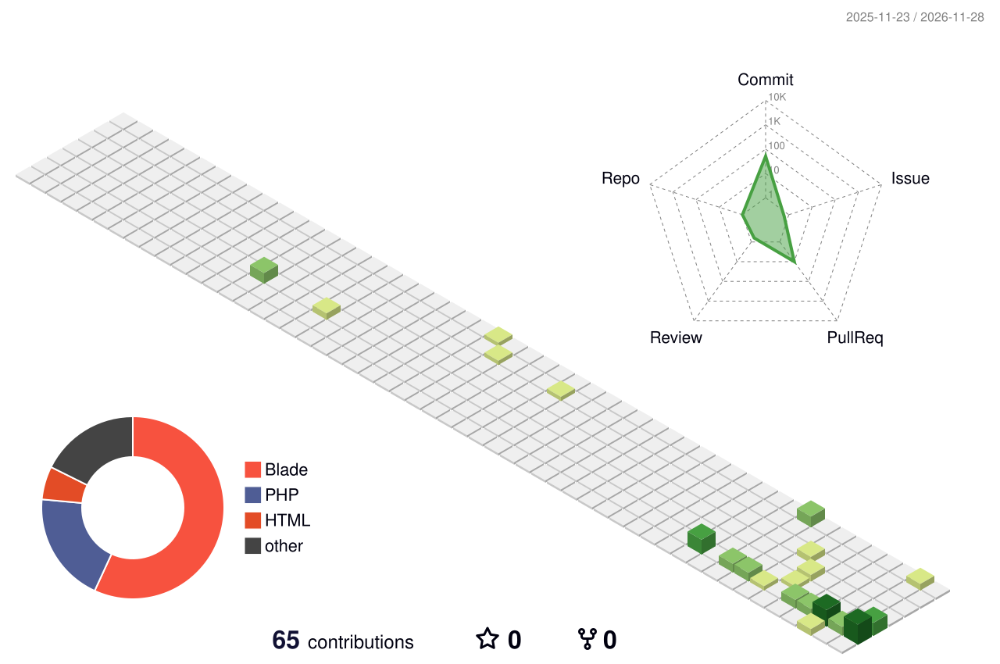

<!-- ============================================== -->
<!-- 01. HEADER                                     -->
<!-- ============================================== -->

  

  <h1>
    Hello, &lt;coders/&gt;! 👋
  </h1>

  

    Exploring Cybersecurity, Data Analytics, and Software Development.
  

<!-- ============================================== -->
<!-- 02. PROFILE INFORMATION                        -->
<!-- ============================================== -->

  

  

  

---

<!-- ============================================== -->
<!-- 03. ABOUT ME                                   -->
<!-- ============================================== -->

## 👨‍💻 About Me

Hello! I'm **Fikrii Abdillah Khoiristi**, a third-semester
Informatics student at Telkom University.

My primary interest is **Cybersecurity**, with an additional
interest in **Data Analytics**.

I have academic experience in backend development,
web programming, and database management.

- 🔭 Currently working on: Academic Web Development Project
- 🌱 Currently learning: Network Security, Linux, and Data Analytics
- 💻 Interested in: Backend Development and Database Management
- 🎯 Career Goal: Building a career in Cybersecurity
- 📚 Always learning and improving my technical skills

---

<!-- ============================================== -->
<!-- 04. TROPHIES                                   -->
<!-- ============================================== -->

## 🏆 GitHub Achievements

  

<!-- ============================================== -->
<!-- 05. LANGUAGES AND TOOLS                        -->
<!-- ============================================== -->

## 🛠️ Languages and Tools

### 💻 Programming & Web Development

  

  

  

  

  

### 📊 Data Analytics & Database

  

  

  

  

  

  

### 🔐 Cybersecurity

  

  

  

---

<!-- ============================================== -->
<!-- 06. GITHUB STATISTICS                          -->
<!-- ============================================== -->

## 📈 GitHub Statistics

  

  

---

<!-- ============================================== -->
<!-- 07. ACTIVITY GRAPH                             -->
<!-- ============================================== -->

## 📊 GitHub Activity

  

---

<!-- ============================================== -->
<!-- 08. GITHUB STREAK                              -->
<!-- ============================================== -->

## 🔥 Contribution Streak

  

---

<!-- ============================================== -->
<!-- 09. CURRENT PROJECT                            -->
<!-- ============================================== -->

## 🚀 Currently Working On

### Tugas Besar — Pemrograman Berbasis Web

Currently developing an academic web application
to strengthen my understanding of backend development,
database integration, and software engineering.

Project details and implementation screenshots
will be added as the project progresses.

---

<!-- ============================================== -->
<!-- 10. WAKATIME STATISTICS                        -->
<!-- ============================================== -->

## ⏱️ WakaTime Coding Activity

<!--START_SECTION:waka-->
<!--END_SECTION:waka-->

---

<!-- ============================================== -->
<!-- 11. GITHUB METRICS                             -->
<!-- ============================================== -->

## 📊 GitHub Metrics

  

---

<!-- ============================================== -->
<!-- 12. 3D CONTRIBUTION PROFILE                    -->
<!-- ============================================== -->

## 🌌 3D Contribution Profile

  

<!-- ============================================== -->
<!-- 13. CONTRIBUTION SNAKE                          -->
<!-- ============================================== -->

## 🐍 GitHub Contribution Activity

<picture>
  <source media="(prefers-color-scheme: dark)" srcset="https://githubusercontent.com" />
  <source media="(prefers-color-scheme: light)" srcset="https://githubusercontent.com" />
  
</picture>

<!-- ============================================== -->
<!-- 14. CONNECT WITH ME                            -->
<!-- ============================================== -->

## 🤝 Connect With Me

  

  

  

---

  <h3>Learning · Building · Growing 🚀</h3>

  

    Thank you for visiting my GitHub profile!
  

